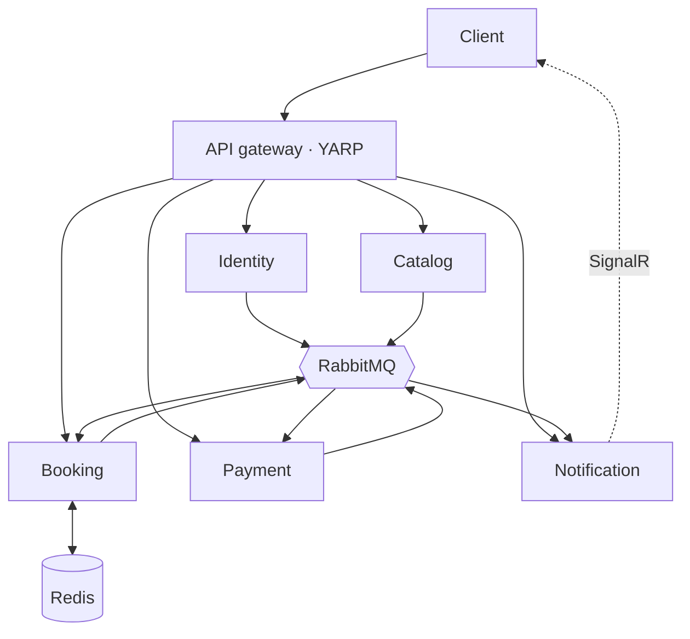

# TicketNow

An event ticketing system built as .NET 8 microservices.
It focuses on the flash-sale problem: thousands of users competing for a limited
number of tickets within seconds, with no overselling and no lost orders.


## Measured results

| Metric | Value |
|---|---|
| 200 concurrent requests competing for 50 tickets | exactly 50 sold, 0 oversold |
| p95 booking latency | <your number> ms |
| Redis data completely lost | inventory is rebuilt from Postgres on startup |
| RabbitMQ down during booking | 0 events lost, synced automatically once it is back |

## Architecture



Each service owns its own Postgres database and never queries another service's
database. Shared data is synchronized through events.

## Getting started

```bash
cp .env.example .env
docker compose --profile app up -d --build
```

| Component | URL |
|---|---|
| API gateway | http://localhost:5000 |
| Realtime test page | http://localhost:5005 |
| Jaeger | http://localhost:16686 |
| RabbitMQ | http://localhost:15672 (ticketnow/ticketnow) |
| MailHog | http://localhost:8025 |

Admin account: `admin@ticketnow.local` / the `SEED_ADMIN_PASSWORD` value in `.env`.

## Technical problems solved

**Preventing oversell.** Inventory is a Redis counter decremented by a Lua script,
so checking and decrementing happen atomically. The naive approach (GET, then
DECRBY from the application) already lets race conditions slip through with a few
dozen concurrent requests. Postgres has `CHECK (sold <= total)` as the last line
of defense.

**No lost events (outbox pattern).** Business changes and their events are written
in the same transaction. A background service reads the outbox table with
`FOR UPDATE SKIP LOCKED` and publishes to RabbitMQ. If the broker is down, events
stay in the database until they can be sent.

**Exactly-once processing (inbox pattern).** The outbox guarantees at-least-once
delivery, so consumers may receive duplicates. Each consumer records the
`message_id` in an inbox table in the same transaction as its business change;
duplicate messages are skipped.

**Side effects outside the database.** Returning tickets to Redis and sending
emails can't be part of a Postgres transaction, so deduplication happens in Redis
itself, using `SET NX` inside the Lua script that releases tickets.

**Saga with compensation.** If a payment arrives just after its order expired, the
system does not issue tickets; it publishes `PaymentRefundRequested` to refund the
payment automatically.

**Idempotency.** The booking endpoint requires an `Idempotency-Key` header; resending
the same key returns the original order with an `Idempotent-Replayed` header.

**End-to-end tracing across the message queue.** The `traceparent` is stored with
each event in the outbox table and restored at publish time, so a single Jaeger
trace spans from the HTTP request through RabbitMQ to consumers in other services.

## Tech stack

.NET 8 · PostgreSQL · Redis · RabbitMQ (MassTransit) · YARP · SignalR ·
OpenTelemetry + Jaeger · Testcontainers · k6 · Docker Compose · GitHub Actions
